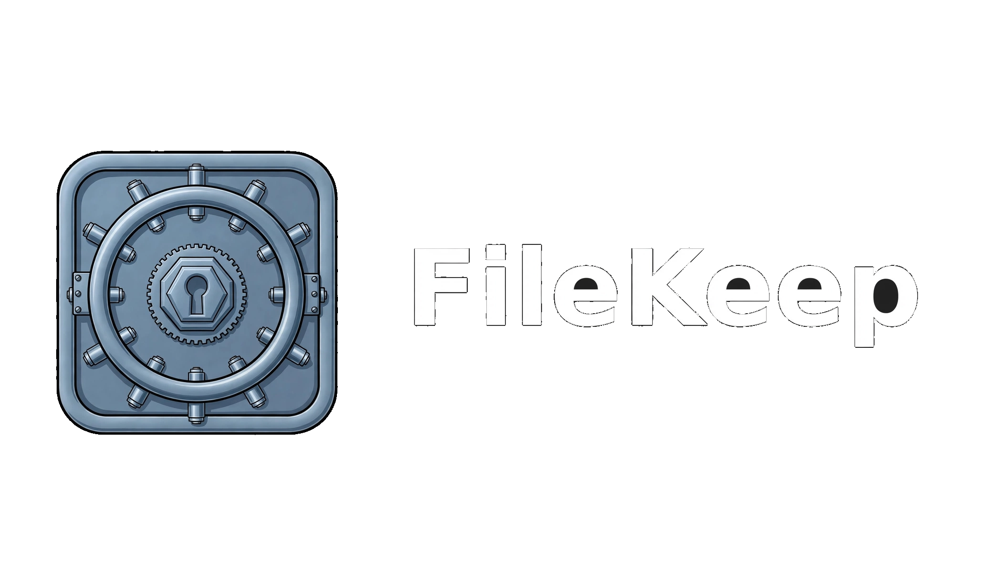

# FileKeep



**Encrypted backups that live on Usenet.** FileKeep is a Windows backup application that encrypts your files client-side and stores them as ordinary Usenet articles — no cloud subscription, no vendor lock-in, just your data, retrievable from any Usenet provider with enough retention.

[](LICENSE)
[]()
[]()

## What it does

- **Full and incremental backups** of directories and whole disks, with content-defined chunking and cross-backup deduplication
- **Client-side authenticated encryption** (AES-256-GCM) — the passphrase never leaves your machine and is never stored with the backup data
- **Usenet as storage** — chunks are posted as yEnc articles to any NNTP provider; NZB indexes track them
- **Volume packing** — encrypted chunks are packed into deterministic 32 MiB volumes at upload time, so one NNTP article carries many chunks (`init --volume-size` tunes it, `nntp-upload --no-volumes` restores one-article-per-chunk)
- **Upload preflight** — `nntp-check --probe-post-size auto` binary-searches a provider's article-size ceiling, and every upload proves the provider will accept the largest planned volume *before* posting anything
- **SMB targets** — mirror a repository to an SMB share (your NAS) with `smb-sync`; the recovery wizard restores straight from the share, no Usenet round-trip
- **Volume Shadow Copy (VSS)** snapshots for point-in-time backups of open and locked files — available via `backup --vss` and per scheduled job (`"vss": true` in service config)
- **Reed–Solomon parity** for recovery from damaged or missing articles
- **Retention management** — monitors article age against provider retention and reposts with fresh identities before articles expire
- **Windows service + web dashboard** for scheduled backups, styled like Windows Settings with dark-mode support
- **Restore path hardening** — manifest paths are lexically anchored inside the destination (traversal, absolute, and UNC paths rejected) and pre-existing symlinks/junctions in the destination tree are never followed during restore
- **Bootable WinRE recovery USB** (Windows 95 Setup-style wizard) for bare-metal restores — built ADK-free from the host's own WinRE image
- **Stealth Folders** — encrypted folders kept on USB/SMB destinations (never Usenet), opened from memory while unlocked and locked away afterwards, with one-way Save As export and encrypted package export/import
- **Disguised destinations** — a USB/SMB location can store its files under innocuous cover-folder names with deterministic hashed filenames, decoy files, and spoofed file headers instead of the usual chunks/manifests layout
- **YubiKey and TOTP security** — passphrase-free YubiKey-only profiles, TOTP as a second factor, and restore gating that asks for proof once per GUI session instead of per restore

## Installation

Download `FileKeep-Setup.exe` and run it. Installs to `C:\Program Files\FileKeep\`:

| Path | Contents |
|------|----------|
| `cli\FileKeep.exe` | Command-line interface |
| `cli\FileKeepVss.exe` | Native VSS snapshot helper |
| `service\FileKeepService.exe` | Windows service + web dashboard |
| `wizard\FileKeepRecovery.exe` | Recovery wizard (also used in WinRE) |
| `docs\` | Recovery runbook and format docs |

The installer registers the `FileKeep` service (starts on first boot) and otherwise stays out of your way — no Start Menu clutter, no tray icon.

## Quick start

```powershell
# 1. Create a repository (passphrase via env var — never on the command line)
$env:FILEKEEP_PASSPHRASE = "your-passphrase"
FileKeep.exe init C:\backups\repo

# 2. Back up a directory (incremental against the previous backup)
FileKeep.exe backup C:\backups\repo C:\Users\you\Documents --parent <previous-backup-id>

# 3. Upload to Usenet
$env:FILEKEEP_NNTP_PASSWORD = "your-nntp-password"
FileKeep.exe nntp-upload C:\backups\repo <backup-id> --host news.example.com --user youruser

# 4. Generate an NZB index for the backup
FileKeep.exe nzb-generate C:\backups\repo <backup-id> backup.nzb

# 5. On another machine: download and restore
FileKeep.exe download C:\backups\repo2 backup.nzb --host news.example.com --user youruser
FileKeep.exe verify C:\backups\repo2 <backup-id>
FileKeep.exe restore C:\backups\repo2 <backup-id> C:\restored
```

More commands: `backup-disk` / `restore-disk` (whole-disk imaging), `nntp-check` (connection test; `--diagnose` probes 119/563/443 with classified failures and falls back to a free server to distinguish ISP blocking from provider issues; `--probe-post-size auto` finds the provider's article-size ceiling before you upload), `retention-check` (article-age audit with `--dry-run`), `smb-sync`, `expiration-check`, `list`.

Backing up locked files (databases, Outlook PSTs, etc.):

```powershell
# As administrator: enables SeBackupPrivilege to read exclusively-locked files
FileKeep.exe backup C:\backups\repo C:\data --backup-privilege

# Point-in-time VSS shadow copy (Windows only, admin required).
# The service also supports VSS per scheduled job via the "vss" config flag.
FileKeep.exe backup C:\backups\repo C:\data --vss
```

## Components

| Component | Description |
|-----------|-------------|
| **CLI** (`FileKeep.exe`) | Full backup/restore/verify/upload/download/NZB/retention toolkit for automation and scripts |
| **Service** (`FileKeepService.exe`) | Windows service running scheduled jobs from `service.json`; serves the dashboard at `http://127.0.0.1:15789/` |
| **Dashboard** | Web UI in the Windows Settings visual language, with OS dark-mode support: job status, run-now, backup lists, operations log, Usenet provider config (passwords stored via DPAPI, never exposed to the UI) |
| **Recovery wizard** (`FileKeepRecovery.exe`) | Windows 95 Setup-style step-through: unlock repo → pick backup → download → verify → restore |
| **VSS helper** (`FileKeepVss.exe`) | Minimal native helper implementing the full VSS backup lifecycle (`GatherWriterMetadata` → `PrepareForBackup` → `DoSnapshotSet` → `BackupComplete`/`AbortBackup`), so writers like SQL Server are never left in a dangling backup state |
| **WinRE USB** | Bootable recovery environment containing the CLI, recovery wizard, and runbook — built ADK-free from the host's WinRE image |

### Recovery USB

Build bootable recovery media from the dashboard (**Recovery** → **Build WinRE recovery media**) or with `winre\build-winre-usb.ps1` (run as admin, no ADK required). The script formats the target USB drive and installs the customized WinRE image with FileKeep tools.

Boot mode defaults to `Both` — an MBR-partitioned FAT32 volume that boots legacy BIOS and UEFI machines (override with `-BootMode UEFI` or `-BootMode BIOS`). With `-ImagePath C:\path\filekeep-recovery.vhdx` the builder writes a bootable disk image file instead of touching a USB drive — handy for Hyper-V or for writing the image later with another tool. The dashboard exposes the same choice with live progress, percent, ETA, and a step checklist.

Only USB-attached drives are eligible targets; the command refuses fixed drives, checks the ISO fits, and declines when stdin isn't interactive (unless `--yes`).

## Stealth Folders and disguised destinations

Stealth Folders are offline folders: files kept encrypted on a USB or SMB destination, not posted to Usenet. Prerequisites are a security method (passphrase or YubiKey) and a USB/SMB backup location. Unlock once, create a folder, and add files from the desktop app's native picker or a browser upload — files are chunked and encrypted onto the location. While unlocked, the folder is served from memory over a loopback WebDAV share, so Open is memory-only (read-only or editable) and Save As is a one-way decrypted export. Locking drops the share, clears open tokens, and zeroes the keys. A folder can be exported as an encrypted package (you choose an export passphrase) and imported on another machine, where it is re-encrypted under that machine's secret; forgetting removes the catalog entry only, leaving destination chunks orphaned. Rekey moves a folder to a new secret. The offline unlock session is separate from the restore session, lapses after an hour idle, and TOTP can never unlock offline folders.

A USB/SMB location can instead be disguised at creation (this cannot be changed afterwards): its files live under an innocuous cover folder name with deterministic SHA-256-derived filenames instead of the usual chunks/manifests layout, with optional decoy files and spoofed file headers (fake JPEG/PNG/MP4/MOV/AVI headers, detected and stripped on read). Offline files stored on a disguised location inherit its layout and header wrapping automatically.

Changing the passphrase orphans banked vaults, since repos open by deriving their key from the passphrase. The Banked Vault tab's **Migrate vaults** button moves every job to fresh vaults under the new secret: fresh repos are created, jobs are re-pointed at them, and shared SMB/USB destinations get fresh pools (a sibling folder for SMB, a new folder or cover name for USB). Usenet locations are shared safely and left alone; the old repos are kept as previous vaults, and the next runs repopulate the new vaults from source. Leave the new-secret field blank to migrate after changing the passphrase, or type the new secret to migrate first and then change the passphrase to match before the next run.

## How it works

1. **Chunk** — files are split into content-defined chunks (~4 MB default), hashed with SHA-256; identical chunks across backups are stored once
2. **Encrypt** — each chunk is encrypted with AES-256-GCM under a key derived from your passphrase (PBKDF2-HMAC-SHA-512, 600k iterations)
3. **Parity** — Reed–Solomon parity shards are generated per chunk group for damage recovery
4. **Post** — encrypted chunks are packed into deterministic 32 MiB volumes and posted as yEnc NNTP articles (one article per volume) with deterministic message-IDs; uploads resume after interruption via a local journal plus server STAT checks, and preflight proves the provider accepts the largest volume before anything is posted
5. **Index** — an NZB 1.1 file maps chunks to articles; the encrypted manifest is also posted so the recovery wizard can discover backups newer than your USB stick
6. **Retain** — a retention manager periodically STATs a sample of articles (default 10 per backup — a lightweight health check, not a proof that every article survives) against provider retention. If any sampled article is missing or the backup nears expiry, *all* chunks are republished under fresh message-IDs before the retention clock resets; a partial failure leaves the old timestamp in place so the next run retries
7. **Restore** — download via NZB, per-chunk authentication and hash verification, decrypt, reassemble; `verify` proves integrity independently of the backup that created it

Every backup is independently verifiable, every uploaded object carries a cryptographic hash, and interrupted uploads/downloads resume where they left off.

## Security model

- **Passphrase handling.** The key is derived at runtime and zeroed on dispose; it is never written to the repository. Prefer the `FILEKEEP_PASSPHRASE` environment variable or the interactive prompt — `--passphrase` on the command line is visible in the process list (the CLI warns about this).
- **YubiKey-only profiles.** A passphrase-free profile: FileKeep generates a 256-bit secret, the YubiKey wraps it by challenge-response, and the wizard's recovery sheet shows the secret once as the paper path. A DPAPI copy stays on the machine for unattended scheduled backups, relinking a key re-wraps the same secret (generation is once-ever), and a passphrase can be added later as an additional wrap that never replaces the key. Spare keys can be programmed from the dashboard.
- **TOTP second factor.** TOTP is secondary-only, never a sole method: it proves security-config changes and restores at the same level as a passphrase or key touch, with 5 failed codes causing a 5-minute lockout and one code usable for exactly one proof. USB/WinPE recovery never uses TOTP.
- **Restore gating.** Backup jobs never prompt. Only restores ask: the first restore attempt in a GUI session prompts once (touch, passphrase/recovery secret, or TOTP — all equal), and further restores in that window proceed without re-prompting. Authorization lapses after an hour idle or when the GUI closes, and a reopened GUI always starts locked.
- **What's public.** Chunk message-IDs embed the SHA-256 of the plaintext chunk (required for content addressing and dedup). Volume articles embed the SHA-256 of the packed volume bytes instead — still deterministic, so the guess-confirmation caveat applies to volume-packed uploads too. Ciphertext is safe, but anyone with an NZB can confirm guesses about plaintext. Filenames are plaintext in manifests (a v1 tradeoff for independent verifiability). There is no forward secrecy: a compromised passphrase decrypts all past Usenet posts.
- **Dashboard.** Binds to loopback only. NNTP passwords are stored via Windows DPAPI and never exposed to the UI.
- **Destructive commands.** `restore-disk` overwrites a block device; it requires typing the device path to confirm (or `--yes` for scripts).
- **Dependencies.** `dotnet list package --vulnerable` is clean (SQLitePCLRaw CVE-2025-6965 patched via upgrade to 2.1.12).

## Backup format

Posted articles use the v2 anonymous format: hex filenames with `- yEnc` subjects, `X-Set` / `X-Part` / `X-Block` / `X-Version` headers, and `@invalid` message-IDs (see `ArticleCodec`). Additional docs:

- [`docs/RECOVERY.md`](docs/RECOVERY.md) — bare-metal recovery runbook
- [`docs/VSS-DESIGN.md`](docs/VSS-DESIGN.md) — VSS snapshot lifecycle design
- [`docs/VOLUME-PACKER-DESIGN.md`](docs/VOLUME-PACKER-DESIGN.md) — volume packing format and upload policy
- [`docs/ROADMAP.md`](docs/ROADMAP.md) — where the project is headed

## Development

```sh
dotnet build FileKeep.slnx
dotnet test FileKeep.slnx   # suite validated green on Windows
```

The core engine builds and tests cross-platform; Windows-only paths (backup privilege, VSS helper, service hosting, WiX installer) need a Windows 10/11 machine. The service also runs in `--console` mode on any OS for development.

Key engineering rules for contributors:

- No hand-rolled crypto — established, boring, conventional implementations only
- Never store encryption keys with backup data
- Every backup independently verifiable; every uploaded object hashed
- Interrupted transfers resume; no silent data deletion
- All modules have automated tests; nothing merges red

## Status

FileKeep is in active development (v0.09.01). The full backup → Usenet upload → download → verify → restore loop is validated against a live Usenet provider. Retention management, Reed–Solomon parity, volume-packed uploads with provider size preflight, the Windows service/dashboard, VSS snapshots (CLI `--vss` and scheduled-job `"vss"` flag), SMB share targets, restore path hardening, the WinRE recovery environment, Stealth Folders, disguised destinations, YubiKey/TOTP security with restore gating, and vault migration are implemented and tested.

On the roadmap: merge/selective restore (deferred to v2), scheduled deep verification, and broader provider compatibility testing.

## License

Proprietary commercial license — see [LICENSE](LICENSE). Copyright © 2026 J. Treichel. All rights reserved.

New versions of FileKeep are commercial software: you may install and use it, but you may not redistribute it, modify it, create derivative works from it, or sublicense it.

License history — released versions keep their licenses permanently; only future versions change:
- Versions up to and including 0.8.1: MIT.
- Versions after 0.8.1 through the final GPL release: GPL-3.0-only.
- New versions: proprietary commercial (this license).
